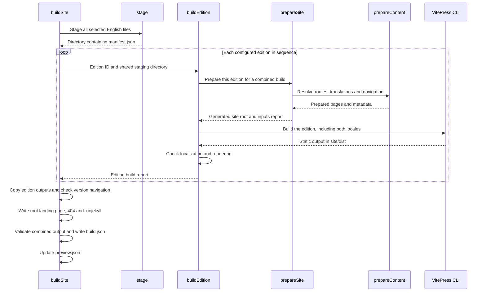

# Architecture

## Developer overview

The publishing system runs at build time. Its unit of input is a selected file at an edition's pinned Git commit. Its unit of deployment is one static directory containing **all** configured editions. GitHub Pages serves those files. Navigation and local search run in the browser using assets built for the selected edition.

For example, a selected `packages/gitlode/docs/usage.md` produces both `/docs/stable/en/usage/` and `/docs/stable/ja/usage/` when the edition path is `stable`. Both pages refer to the same upstream blob. The Japanese route exists even when its body comes from the English original. To trace that page through the code, start at [`buildSite`](../../src/ssg/vitepress/build.ts), then follow [`prepareContent`](../../src/publishing/content.ts) for the choice of body and route.

The [shared overview](../overview.md) covers the repository layout and local preview. The sections below describe the implementation of a complete build and the contracts that changes must preserve.

## Design principles

**Keep publishing as simple as possible.** The documentation system
publishes gitlode's documentation in a form that is easy to use when
using or developing gitlode. To keep the project's development effort
focused on gitlode itself, reuse existing software wherever possible.
Use VitePress as the static site generator and keep the custom code that
coordinates the build and fills gaps in VitePress as simple as possible.

### Publishing and maintenance rules

- **Explicit publication.** Each edition has a list of permitted documents. Sidebar groups can order or omit entries from that list. Following a Markdown link never adds a document to it.
- **Edition-independent processing.** The edition ID selects configuration. The public path, display label and upstream revision are separate fields. Keeping a released edition's navigation fixed is an [operating policy](../operations/editions.md#stable-release-policy). All editions use the same build and translation rules.
- **Traceable inputs.** The gitlode project owns the English source. This repository owns configuration, translations and renderer code. Transformations apply to generated copies. The staging manifest and per-edition reports identify the inputs used for each page.
- **Predictable operation.** A maintainer chooses the revision to publish and the source and destination of a translation transfer. The build can detect that English text changed. A reviewer decides whether the translation conveys its meaning.

## Component responsibilities

| Component                                                                            | Responsibility and interface                                                                                                                                                          |
| ------------------------------------------------------------------------------------ | ------------------------------------------------------------------------------------------------------------------------------------------------------------------------------------- |
| [Publication services](../../src/publishing/)                                        | Acquire Git objects, stage selected files, prepare pages and navigation. Also provide static serving and HTML reference validation. These modules have no VitePress dependency.       |
| [VitePress adapter](../../src/ssg/vitepress/)                                        | Consume prepared pages, generate renderer inputs, invoke VitePress and assemble edition outputs. Own checks that depend on theme markup, version controls or the search index format. |
| [Site configuration](../../site/vitepress/)                                          | Configures the VitePress default theme, including language controls, fallback markup and edition navigation. The adapter copies these trusted files into each build root.             |
| [Publication CLI](../../src/publishing/cli.ts) and [site CLI](../../src/cli/site.ts) | Dispatch acquisition, staging and translation transfer to publication services, and preparation, build, preview and HTTP verification to the adapter.                                 |
| [Pages workflow](../../.github/workflows/docs.yml)                                   | Run validation and, on manual runs, select the combined artifact. A separate deployment job holds Pages and OIDC write permissions.                                                   |

## Build execution

### One staging run feeds all edition builds

The diagram follows `npm run site:build` with no edition argument. Before it starts, `source:acquire` fetches the configured refs into `.generated/source`. If a ref moved, acquisition fetches the configured commit and retains that pin. The build reads local Git objects. Running `content:stage` separately produces an inspection run; the complete build creates its own staging run.

`site:prepare` stops after generating one edition's inputs. A single-edition diagnostic build runs VitePress and validates its own output without cross-edition controls. It can become the local preview. Publication requires a combined build.

### Verification and publication follow the build

HTTP and search verification are separate commands that read the selected build. HTTP probes serve the static files on loopback and check document, landing and missing-page responses. Search verification serves the built index assets, queries the indexes and checks result paths and fragments. These commands run after the build in CI.

On a manual run from `main`, the [candidate selector](../../src/cli/pages-candidate.ts) checks the combined report, base path and staging manifest, including the clean docs revision against the workflow SHA. Only the selected `dist/` is uploaded. An empty publication SHA prepares a candidate. Supplying the matching SHA deploys the artifact produced and verified by that run. See [deployment and recovery](../operations/deployment.md).

## Content model

### Document identity and links

The source path determines the route within each locale. For example, `design/README.md` becomes `design/`. Preparation rejects case-insensitive route collisions. Relative links resolve against the canonical source path and pinned Git tree, including links written in Japanese translations. A selected target becomes an internal link. A valid unselected upstream file or directory becomes a link at the pinned commit. Missing targets and symlinks fail validation. See [publication and navigation](../operations/publication.md).

### Translation state and page behavior

Each English page is canonical. For each Japanese page, [translation loading](../../src/publishing/translations.ts) compares the recorded English SHA-256 with the **selected file's** SHA-256.

| Japanese input                  | Generated page                                                                                                                |
| ------------------------------- | ----------------------------------------------------------------------------------------------------------------------------- |
| No translation record           | English body marked with `lang="en"` and a fallback notice. Body links follow the English locale. The sidebar stays Japanese. |
| Translation and matching hash   | Japanese body. The match identifies the reviewed source bytes.                                                                |
| Translation and different hash  | Japanese body with a source-change notice.                                                                                    |
| Record points to an absent file | Build error.                                                                                                                  |

Translation transfer is a separate operation. It preserves existing destination translations and carries the original checked hash with each copy. See [translation operations](../operations/translations.md#transfer-between-editions).

Language switching targets the same document in the other locale. Heading IDs can differ across translations. The VitePress default theme's `nav` menu lists the configured editions for the current locale. Edition links use `target="_self"` for a full navigation to the selected edition's home because each edition has its own built client. VitePress adds the current edition base to sibling links, and the browser resolves their parent path segment on the same host. Each edition also has separate locale search indexes. An English fallback body is searchable in the Japanese index at its Japanese URL.

## Trust boundaries

[Staging](../../src/publishing/pipeline.ts) reads regular blobs using Git tree and object commands, preserving their bytes. It rejects unsupported paths and entries, including traversal, symlinks and submodules. Generated directory checks reject symlinks and junctions. Concurrent hostile mutation of the local filesystem is outside this model.

Staged Markdown is still untrusted. Preparation rechecks its hash and applies the [Markdown policy](../../src/publishing/markdown.ts) to the chosen English or Japanese body. It rejects raw HTML, imported frontmatter, Vue expressions outside code, unsafe URLs, imported images and include directives. Include comments are rejected even inside code fences because the renderer expands them before Markdown parsing. Serialization and link rewriting affect generated Markdown only.

The adapter adds trusted frontmatter, attribution, landing pages and VitePress configuration after content preparation. Rendering checks compare generated HTML with snapshots, including headings and code blocks. Combined-output checks validate local references and fragments under the deployment base and reject excluded output. External HTTP links are not fetched. See the [VitePress upgrade checks](../contributing/development.md#vitepress-upgrades) when changing the renderer or its configuration.

## Build artifacts and failure behavior

All paths below are relative to `.generated/`. For a build failure, inspect the report closest to the failing step.

| Artifact                                                          | What it establishes                                                                                                                                                                                  |
| ----------------------------------------------------------------- | ---------------------------------------------------------------------------------------------------------------------------------------------------------------------------------------------------- |
| `staging/run-*/manifest.json`                                     | Staging completed. Written last, it records source paths, blob IDs, file hashes, edition pins, configuration hash and docs revision/dirty state. A partial directory can survive an interrupted run. |
| `previews/run-*/inputs.json` and `previews/run-*/site/snapshots/` | Identify the route, canonical source, chosen render input and translation status before VitePress runs.                                                                                              |
| `previews/run-*/build.json`                                       | Rendering and localization checks finished for one edition. Other editions or combined validation may still fail.                                                                                    |
| `previews/combined-*/build.json` and `previews/combined-*/dist/`  | All editions were assembled in a fresh directory and combined-output checks passed. The report stays outside the public artifact.                                                                    |
| `preview.json`                                                    | Points preview and subsequent checks to the selected successful build. A build that fails before selection leaves the earlier pointer in place.                                                      |

A failure in the later HTTP or search checks blocks the workflow upload or deployment. It does not roll back the local preview pointer, which was already written by the build. For deployed releases, the publish run and its verified source pins provide the [recovery reference](../operations/deployment.md#recover-a-release).
