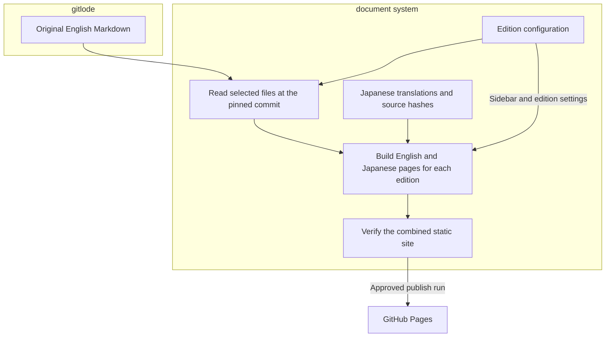

# How the gitlode documentation site works

Each edition brings together three inputs. The **English original** belongs to the
[gitlode project](https://github.com/gitlode/gitlode). To correct it, change the upstream document.
The **Japanese translation** belongs to this repository. The **edition configuration**, also
maintained here, identifies the upstream commit, selects the documents to publish and arranges
them in the sidebar. You can change the sidebar order independently of the source file layout.

## From source to GitHub Pages



For a Japanese page, the build uses the translation when available. If its recorded English
source hash differs from the edition's English file hash, the page displays a review notice.
A missing translation displays the English text with a fallback notice. See
[translation operations](operations/translations.md).

Stable and next are published together. A maintainer can prepare a release candidate on
GitHub Actions, then publish the reviewed revision in a separate manual run that rebuilds
and verifies the site. See [deployment and recovery](operations/deployment.md).

## Preview the site locally

From a checkout of this repository, use Git, Node.js 22.23.4 and npm 11. Install dependencies,
fetch the pinned upstream sources, build the site and start the preview.

```sh
npm ci --ignore-scripts
npm run source:acquire
npm run site:build
npm run preview
```

Open the [local site](http://127.0.0.1:4173/docs/) and choose an edition and language.
After changing configuration or a translation, stop the preview with Ctrl+C, rebuild and
start it again. If you changed an upstream pin, run `npm run source:acquire` before
rebuilding. For automated checks, see [development and validation](contributing/development.md#validation).

## Where to work

| Directory            | What you will find there                                                                                                                                                                  |
| -------------------- | ----------------------------------------------------------------------------------------------------------------------------------------------------------------------------------------- |
| `config/`            | Edition paths and labels, source pins, publication lists and sidebar order. See [edition operations](operations/editions.md) and [publication and navigation](operations/publication.md). |
| `translations/ja/`   | Japanese Markdown and manifests recording the English source hash for each translation.                                                                                                   |
| `src/` and `test/`   | The publishing pipeline, build commands and their tests. See the [architecture](design/architecture.md).                                                                                  |
| `site/vitepress/`    | The VitePress configuration and Vue theme used to render the site.                                                                                                                        |
| `.github/workflows/` | The GitHub Actions workflow that validates changes and publishes the site.                                                                                                                |
| `.generated/`        | Local copies of upstream sources, intermediate files and built previews. The build tools create these files and Git ignores them.                                                         |
| `docs/`              | Guides for developing and operating the documentation system. See the [documentation index](README.md).                                                                                   |
